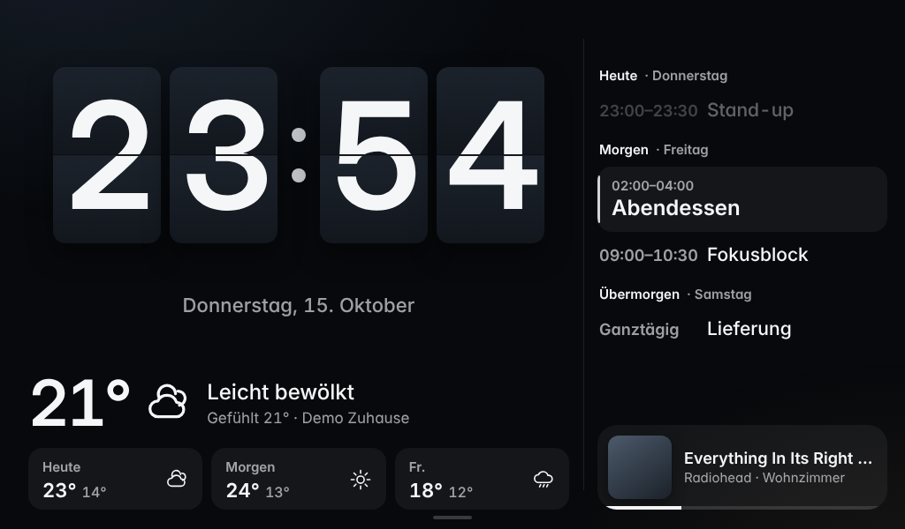
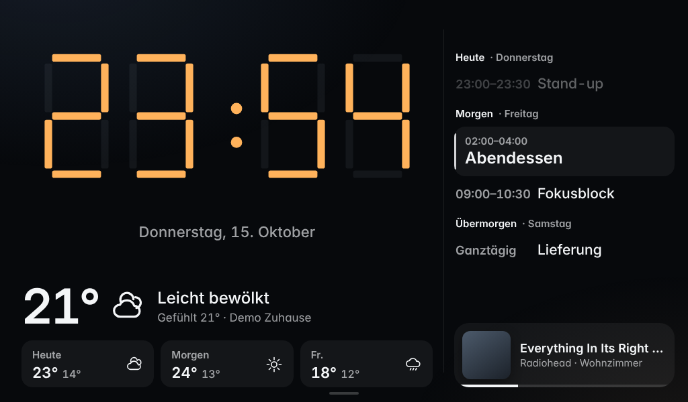
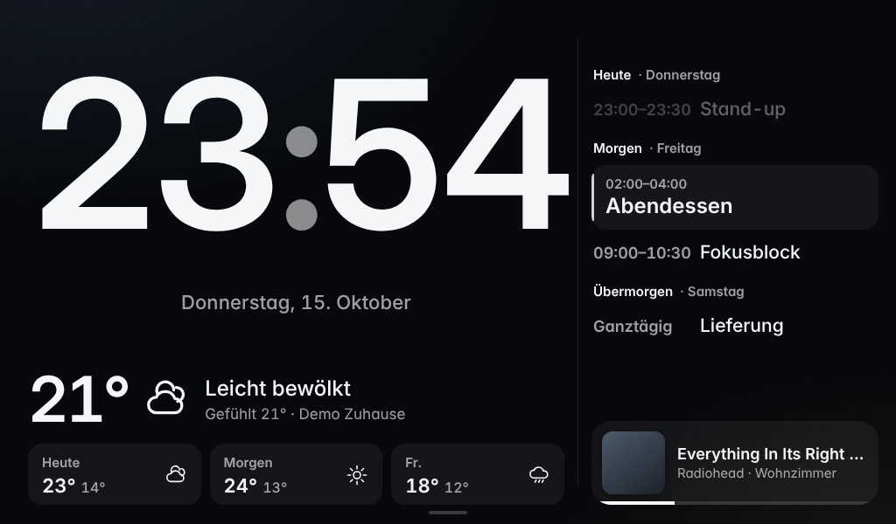
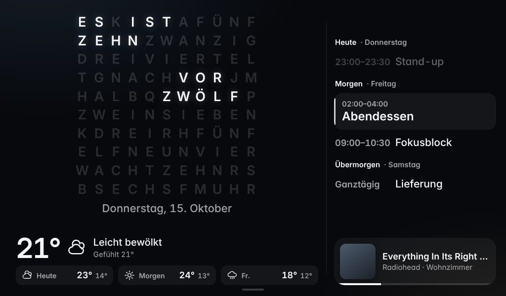
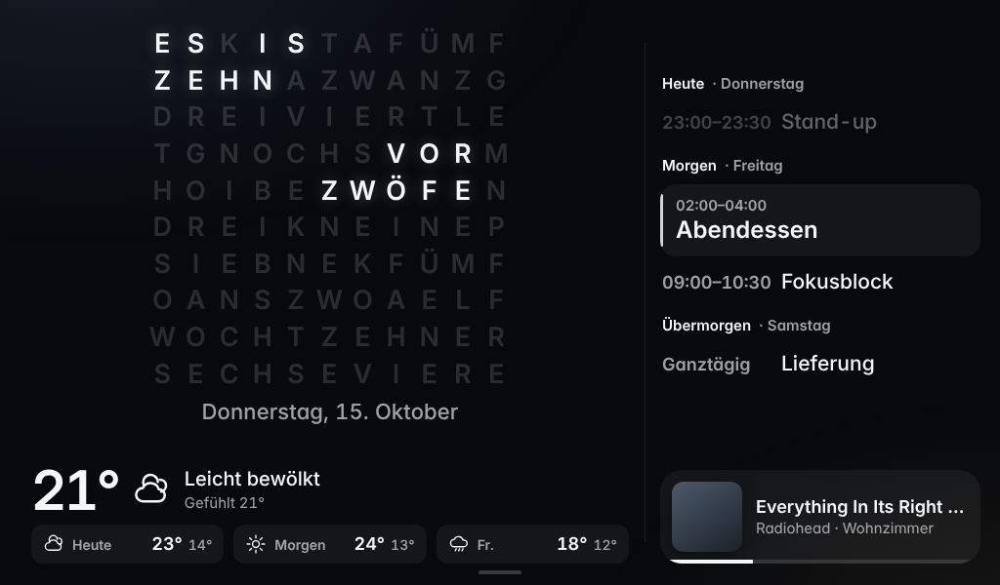
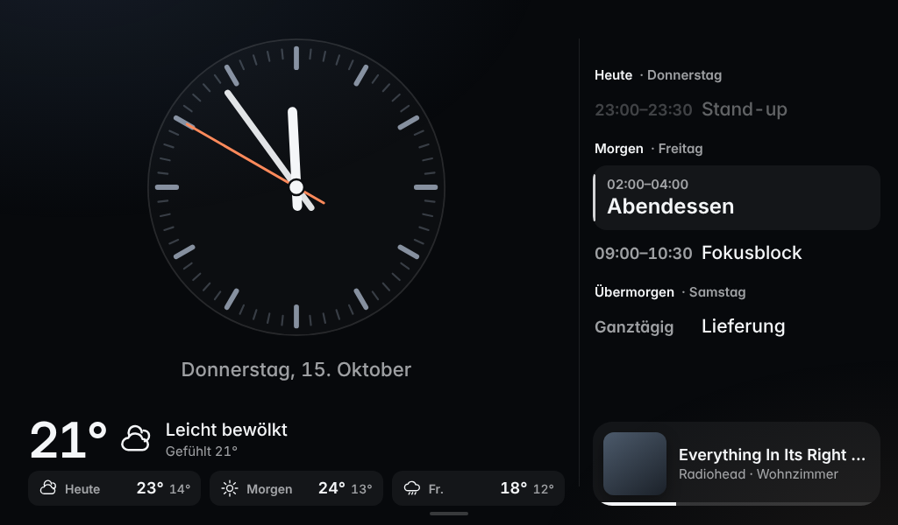

# Smart Display for Raspberry Pi Zero 2 W

Smart-display app for a `1024x600` touch panel in kiosk mode. One Python process fetches weather, calendar (CalDAV), Spotify and screensaver photos (a shared Lightroom album and/or local files) and serves a small server-rendered UI — no SPA, no JS build step on the device.

| | | |
|---|---|---|
|  **Flip** (default) |  **LCD** |  **Pulse** |
|  **QLOCKTWO** |  **QLOCKTWO OÖ** |  **Analog** |

The UI is in German (a personal device), e.g. `Heute` = today, `Stand 15:10` = as of 15:10. QLOCKTWO OÖ is an Upper Austrian dialect word clock.

## Using it

- **Watch faces** — tap the hero clock to cycle through the six faces; the choice persists in `localStorage`.
- **Spotify** — swipe left on the home screen (or tap the music bar) for the full controller: now playing, scrubbing, transport, volume, queue and a device/playlist picker. Swipe right to return. The two sliders keep the horizontal axis.
- **Weather** — swipe left once more from the Spotify screen (order home → Spotify → weather, no wrap-around): current conditions and wind, a 24-hour / today / tomorrow chart of temperature and hourly precipitation, a three-hour rain nowcast in 15-minute bars, and seven days. Tap a day for its values; hourly data exists only for today and tomorrow. Official warnings for the configured location appear as a hint at the top; tap it for the full text.
- **Quick sheet** — swipe up (or tap the bottom grip): up to three countdown timers, watch face, night mode, start screensaver, power off/reboot (hold 2 s; only with `APP_ALLOW_SHUTDOWN=true`).
- **Timers** — shown in the status rail and on the screensaver; when one ends, a full-screen visual alarm (no sound) with stop and +1 min. They survive restarts.
- **Night** — between `APP_NIGHT_FROM` and `APP_NIGHT_TO` (default 22:30–06:00) a dimmed palette, and the screensaver shows a dark clock instead of photos. The sheet overrides it.
- **Screensaver** — starts after the idle timeout or from the sheet. Swipe left/right to page through the photos (the last ten are remembered). Tap the clock or double-tap anywhere to wake; at night any tap wakes. A ringing timer always wins. Active official warnings and those beginning within 24 h show as one quiet line at the top (most severe first, the rest as `+N`); the line is not a tap target.
- **Failures** — a failing provider degrades only its own tile; the last good state survives reboots (`data/last_good.json`); the screensaver keeps its cached photos when the source fails and shows a flip clock when there are none.

## Architecture

Python 3.11, Flask and Waitress; server-rendered HTML plus vanilla JS that polls `GET /api/state`. Background jobs feed a state store, the UI only reads it. On the device, `smart-display.service` runs the backend (loopback only) and `smart-display-kiosk.service` the browser: Cog/WPE straight on DRM (recommended on the Zero 2 W) or Chromium on X11. Release history: [CHANGELOG.md](CHANGELOG.md).

## Running locally

```bash
python3 -m venv .venv && . .venv/bin/activate
pip install -e .
cp .env.example .env
python -m smart_display.app            # :8080, real providers from .env
python -m smart_display.local_server   # :8090, demo data, own data dir
```

`APP_DEMO_MODE=true` runs the first entrypoint without accounts; `.env.local` (see `.env.local.example`) overrides `.env` for the demo server.

Checks: `python3 -m compileall smart_display tests` and `python3 -m unittest discover -s tests`. Against the demo server (Playwright): `scripts/screenshot-states.py OUT_DIR` renders every state, `scripts/take-screenshots.sh` the images above, `scripts/check-gestures.py [--self-test]` the touch gestures in WebKit and Chromium, `scripts/check-freshness.py [--self-test]` the lost-backend hint and the data-age labels. Neither engine is the device's WPE build, so none of this replaces a look at the panel.

## Configuration

Defaults live in `config/default.yaml`; secrets and device-specific values go into `.env`:

- `APP_LOCALE`, `APP_TIMEZONE`, `APP_WATCH_FACE` (`flip`, `lcd`, `pulse`, `qlocktwo`, `qlocktwo-ooe`, `analog`)
- `WEATHER_LATITUDE`, `WEATHER_LONGITUDE`, `WEATHER_LABEL`; `WEATHER_GEOSPHERE_ENABLED` (hourly C-LAEF + INCA nowcast, default `true`), `WEATHER_WARNINGS_ENABLED` (default `true`)
- `REFRESH_WEATHER_SECONDS` (Open-Meteo, 900), `REFRESH_WEATHER_HOURLY_SECONDS` (C-LAEF, 3600), `REFRESH_WEATHER_NOWCAST_SECONDS` (INCA, 900), `REFRESH_WEATHER_WARNINGS_SECONDS` (300)
- `CALENDAR_URL`, `CALENDAR_USERNAME`, `CALENDAR_PASSWORD`, `CALENDAR_NAME`
- `SPOTIFY_CLIENT_ID`, `SPOTIFY_CLIENT_SECRET`, `SPOTIFY_REFRESH_TOKEN`, `SPOTIFY_DEVICE_ID` — get a refresh token with `python3 scripts/spotify-auth.py --client-id <id> --client-secret <secret>` on a machine with a browser, after adding `http://127.0.0.1:8888/callback` as a redirect URI in the Spotify app
- `SCREENSAVER_SOURCE_URL`, `SCREENSAVER_IDLE_TIMEOUT_SECONDS`, `SCREENSAVER_REFRESH_INTERVAL_SECONDS`; own photos go into `data/screensaver-local/`
- `APP_NIGHT_FROM`, `APP_NIGHT_TO` (`HH:MM`, empty disables), `APP_ALLOW_SHUTDOWN` (default `false`)

## Weather sources

All server-side, one point query each, small JSON only — the browser never calls a provider.

| Data | Source | Endpoint and parameters |
|---|---|---|
| Home weather, screensaver, 7 days (min/max, code, rain probability and sum, sunrise/sunset), hourly fallback | [Open-Meteo](https://open-meteo.com/) | `api.open-meteo.com/v1/forecast`, `timeformat=unixtime` (ISO local times are ambiguous on DST days) |
| Hourly today/tomorrow: temperature, wind, gusts, precipitation, symbol | GeoSphere Austria C-LAEF | `dataset.api.hub.geosphere.at/v1/timeseries/forecast/nwp-v2-1h-1km`, `2t,10u,10v,10fg,tp,sy` |
| Rain nowcast, 3 h in 15 min | GeoSphere Austria INCA | `…/timeseries/forecast/nowcast-v1-15min-1km`, `rr` |
| Official warnings | GeoSphere Austria | `warnungen.zamg.at/wsapp/api/getWarningsForCoords?lon=…&lat=…&lang=de` |

Data: GeoSphere Austria and Open-Meteo.com, both [CC BY 4.0](https://creativecommons.org/licenses/by/4.0/); the weather screen names both. GeoSphere covers Austria and its surroundings only: outside, its sources switch themselves off and the hourly chart uses Open-Meteo. Each source has its own status, age and last good data in `data/last_good.json`; a failing source degrades only its part of the screen. Rate limits are respected (429/5xx back off, `Retry-After` honoured, GeoSphere allows 240 requests/hour).

## Deploying to the Pi

First install, on Raspberry Pi OS Lite from a clone of this repo:

```bash
sudo env SMART_DISPLAY_KIOSK_BROWSER=cog bash scripts/install-pi.sh   # drop the env for Chromium/X11
```

It installs packages, the venv and both systemd units into `/opt/smart-display`, plus the systemd watchdog, journald cap, hardware watchdog, zram and the sudoers rule for the power buttons. Then fill in `/opt/smart-display/.env` and reboot. Browser-only settings go into `.kiosk.env` — the browser inherits it, so no credentials there. `SMART_DISPLAY_GPIO_SHUTDOWN=true` lets shorting GPIO3 (pin 5) to GND start a halted Pi. It also adds `video=HDMI-A-1:1024x600@60D` to `/boot/firmware/cmdline.txt` (backup next to it), so a panel that briefly drops HDMI hotplug cannot lock the kiosk out; `hdmi_force_hotplug` in `config.txt` has no effect under KMS. Set `SMART_DISPLAY_HDMI_VIDEO` to another value (e.g. `HDMI-A-2:…` on a Pi 4) or to empty to skip it.

Updates:

```bash
PI_HOST=pi@<your-pi> bash scripts/deploy-pi.sh   # --dry-run, --force-restart
```

It rsyncs the working tree to `/opt/smart-display` and restarts both units only if a file was transferred; docs, tests and `*.md` are excluded, and `.env`, `.kiosk.env`, `data/` and the venv are never touched. Exit code `3` means the Pi was unreachable. Changed systemd units or dependencies need `install-pi.sh` again (in place: `cd /opt/smart-display && sudo bash scripts/install-pi.sh`). A green report means the services came back — Cog renders to DRM, so the panel cannot be screenshotted.

The screensaver pulls one new album photo per 30-minute tick. `PI_HOST=pi@<your-pi> bash scripts/sync-album.sh` pulls the whole album now: new, edited and removed photos (both units stop for about a minute; `--dry-run` only reports).

On the device, `scripts/measure_pi.py --duration 60 --label baseline` writes one JSON line (memory, RSS, CPU, SD writes, `/api/state` latency, restarts) to `data/measurements/`; `scripts/pi/test-panel-blank.sh` checks whether the panel goes dark on DPMS-off; `scripts/pi/check-unit-restarts.sh` checks that the kiosk survives a backend restart, stop + start and crash.

## Known limits

- Spotify needs Premium and a reachable Connect target; volume control via the Web API is reliable only on real Connect speakers.
- Lightroom: the app reads the album API the public share page points to, so a change on Adobe's side can break it; cached photos stay in place.
- Some CalDAV servers may need small tweaks.
- Weather: the INCA precipitation of a step is read as the 15 minutes *ending* at its timestamp (the API documents "last interval" for the comparable C-LAEF `tp`, not explicitly for `rr`). Open-Meteo's daily Unix days are local midnight at one fixed offset per response (checked against a recorded window over the October change, `tests/fixtures/weather/`); the dates are derived with that offset, the hourly values use the exact Unix times. Sun times for icons are an approximation (± a few minutes).
